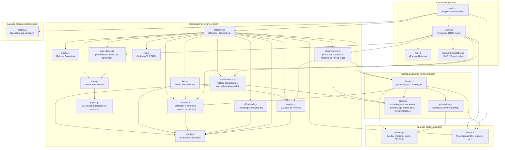

# Documentação Arquitetural e Diagramas UML - Fisher SA

Este documento consolida a modelagem UML e arquitetural do projeto **Fisher SA**, detalhando sua estrutura de dados, máquina de estados, ciclo de vida de execução e separação em camadas.

---

## 1. Diagrama de Classes e Entidades (Estrutural)

Modela o estado da partida, as entidades de negócio (jogadores, cenários, cartas de evento) e os serviços/módulos do sistema.

```mermaid
classDiagram
    direction TB

    class GameState {
        +int versao
        +int seed
        +int rng
        +int turnoAtual
        +int turnosPorJogador
        +int dinheiroInicial
        +int reputacaoInicial
        +boolean falencia
        +int jogadorAtual
        +Fase fase
        +int dado
        +int[] dados
        +boolean jogadaExtra
        +Balanco balanco
        +List~Jogador~ jogadores
        +List~string~ baralhoCenarios
        +List~string~ baralhoEventos
        +Object baralhoInvestimentos
        +CenarioInstanciado cenarioAtual
        +EventoAtual eventoAtual
        +OfertaMercado mercadoAtual
        +List~ApuracaoFinal~ apuracaoFinal
        +Resultado resultado
        +Teste teste
        +boolean soConceitual
        +string progressao
    }

    class Jogador {
        +int id
        +string nome
        +boolean falido
        +boolean negativado
        +Sequencia sequencia
        +Nivel nivel
        +number dinheiro
        +number reputacao
        +int posicao
        +int distancia
        +List~HistoricoDecisao~ historico
        +List~Investimento~ investimentos
        +PerfilBot bot
        +string diretoria
        +List~string~ papeis
        +Map habilidadeUsos
    }

    class Sequencia {
        +int erros
        +int acertos
    }

    class HistoricoDecisao {
        +string cenario
        +string conceito
        +string metrica
        +string justificativa
        +Confianca confianca
        +CategoriaResultado resultado
        +number delta
        +List~string~ equivocos
        +number valor
        +boolean valorCorreto
    }

    class CenarioDef {
        +string id
        +int versao
        +string tipo
        +Object calculo
        +string idioma
        +Nivel nivel
        +int dificuldade
        +string conceito
        +string titulo
        +string contexto
        +string dica
        +number valor_base
        +DadosCenario dados
        +List~Opcao~ opcoes
        +List~Justificativa~ justificativas
        +Feedback feedback
    }

    class Opcao {
        +string id
        +string chave
        +string texto
        +boolean correta
        +string equivoco
    }

    class Justificativa {
        +string id
        +string texto
        +TipoJustificativa tipo
        +string equivoco
    }

    class EventoCarta {
        +string id
        +TipoCarta tipo
        +string setor
        +string titulo
        +string texto
        +string licao
        +number dinheiro
        +number reputacao
    }

    class TipoCarta {
        <<enumeration>>
        boa
        ruim
        troll
    }

    class DecisaoEvento {
        <<enumeration>>
        null
        escolhendo
        trocando
        participou
        recusou
    }

    class EventoAtual {
        +string[] cartas
        +DecisaoEvento decisao
        +int primeira
        +int revelada
        +int escolhida
        +boolean trocou
        +string id
        +boolean crise
        +int dinheiro
    }

    class Investimento {
        +string empresaId
        +string nome
        +Porte porte
        +int valor
        +number prob
        +number ganho
        +number perda
        +boolean consultoria
        +int honorario
        +int turnoAporte
    }

    class OfertaMercado {
        +string empresaId
        +Porte porte
        +number prob
        +number ganho
        +number perda
        +boolean consultoria
        +string diagnostico
        +Analise analise
        +int aporte
        +string decisao
        +int honorarioPago
    }

    class EmpresaDef {
        +string id
        +Porte porte
        +string nome
        +string setor
        +string tempo
        +string fundador
        +int[] historico
        +number prob
        +number ganho
        +number perda
        +Falacia falha
        +string explicacao
        +string sucesso
        +string fracasso
    }

    class InvestimentosService {
        +porteDaReputacao(reputacao) Porte
        +valorEsperado(oferta) number
        +ganhoComConsultoria(ganho, desconto) number
        +honorarioDaConsultoria(consultoria, desconto) number
        +sortearOferta(e, reputacao, rng) OfertaMercado
        +liquidar(investimento, rng) ResultadoInvestimento
        +liquidarTodos(carteira, jogador, rng) List
        +totalInvestido(jogador) number
    }

    class RngService {
        +int estado
        +prox() number
        +entre(min, max) number
        +inteiro(min, max) int
        +normal(media, dp) number
        +embaralhar(lista) Array
    }

    class BotService {
        +acertoEfetivo(perfil, dificuldade) number
        +confiancaDaCerteza(certeza) Confianca
        +decidirBot(def, perfil, rng, num) Escolha
    }

    class CalculoService {
        +ehCalculo(def) boolean
        +margemPct(esperado) number
        +avaliarCalculo(opcao, num, informado) AvaliacaoCalculo
        +valorEsperado(def, cenarioAtual) number
        +notaDeMetodo(chave) string
        +calcularOperacao(valores, id, p) number
        +formatarResultadoCalculadora(r) string
    }

    class DificuldadeService {
        +dificuldadeAlvo(progresso, progressao) number
        +pesoDificuldade(dificuldade, progresso, progressao) number
        +escolherPorDificuldade(candidatos, progresso, rng, progressao) string
    }

    class ScoringEngine {
        +multiplicadorReputacao(reputacao) number
        +justificativaConta(tipo) boolean
        +fatorSequencia(sequencia) number
        +multiplicadorSequencia(categoria, sequencia) number
        +atualizarSequencia(categoria, sequencia) Sequencia
        +classificar(metricaCorreta, justCorreta) CategoriaResultado
        +resolverDecisao(params) ResultadoDecisao
        +receitaBalanco(reputacao) number
    }

    class BoardService {
        +Array~string~ CASAS
        +int NUM_CASAS
        +avancar(posicao, passos) Object
        +coordenadas(i, colunas, linhas) Object
    }

    class ScenarioLoader {
        +obterCenario(id) CenarioDef
        +instanciar(def, rng) Object
        +validarCenario(def, rng) List
        +preencher(texto, vars) string
    }

    class StorageService {
        +salvar(estado) void
        +carregar() GameState
        +limpar() void
    }

    GameState "1" *-- "1..3" Jogador : contém
    Jogador "1" *-- "*" HistoricoDecisao : registra
    Jogador "1" *-- "1" Sequencia : acumula
    Jogador "1" *-- "*" Investimento : mantém em custódia até o Balanço
    GameState "1" o-- "0..1" CenarioDef : executa em 'decisao'
    GameState "1" o-- "0..1" EventoAtual : apresenta em 'evento'
    EventoAtual "1" ..> "3" EventoCarta : mão sorteada (uma boa, uma ruim, uma troll)
    GameState "1" o-- "0..1" OfertaMercado : apresenta em 'mercado'
    OfertaMercado "1" ..> "1" EmpresaDef : sorteada do catálogo
    CenarioDef "1" *-- "5" Opcao : possui
    CenarioDef "1" *-- "6..8" Justificativa : possui
    
    GameState ..> RngService : utiliza seed/estado
    GameState ..> BoardService : consulta trilha
    GameState ..> DificuldadeService : sorteia cenário por progresso
    GameState ..> BotService : decide a vez do rival (modo solo)
    GameState ..> CalculoService : confere o valor dos cenários de cálculo
    GameState ..> InvestimentosService : oferece e apura investimentos
    InvestimentosService ..> RngService : sorteia a oferta e o desfecho
    BotService ..> CalculoService : informa o valor no cenário de cálculo
    ScenarioLoader ..> CenarioDef : gerencia/instancia
    ScoringEngine <.. GameState : calcula pontuação
    StorageService ..> GameState : serializa/deserializa
```



---

## 2. Diagrama de Máquina de Estados (Comportamental)

Modela o fluxo de fases do motor de turnos em `src/engine/machine.js`. Cada transição é uma função pura `(estado, acao) -> novoEstado`.

```mermaid
stateDiagram-v2
    [*] --> MENU : Início / Sem jogo ativo
    
    MENU --> ROLAR_DADO : NOVA partida / CONTINUAR_SALVA
    
    state TurnoAtivo {
        [*] --> ROLAR_DADO
        
        ROLAR_DADO --> ESCOLHER_METRICA : ROLAR (caiu em 'decisao')
        ROLAR_DADO --> MOSTRAR_EVENTO : ROLAR (caiu em 'evento')
        ROLAR_DADO --> MOSTRAR_MERCADO : ROLAR (caiu em 'mercado')
        ROLAR_DADO --> MOSTRAR_BALANCO : ROLAR (caiu em 'balanco')
        
        state FluxoDecisao {
            ESCOLHER_METRICA --> ESCOLHER_METRICA : ABRIR_DICA (só iniciante; marca dicaUsada e reduz o bônus de confiança)
            ESCOLHER_METRICA --> ESCOLHER_METRICA : USAR_HABILIDADE(diretoria) (Plano B, Dashboard ou Treinamento; 2 usos por partida e 1 por cenário)
            ESCOLHER_METRICA --> ESCOLHER_JUSTIFICATIVA : METRICA(id) (só pessoa, cenário comum)
            ESCOLHER_METRICA --> INFORMAR_VALOR : METRICA(id) (só pessoa, cenário de cálculo)
            INFORMAR_VALOR --> ESCOLHER_JUSTIFICATIVA : VALOR(número ou texto pt-BR)
            ESCOLHER_METRICA --> MOSTRAR_RESULTADO : DECIDIR_BOT (só rival do modo solo)
            ESCOLHER_JUSTIFICATIVA --> ESCOLHER_CONFIANCA : JUSTIFICATIVA(id)
            ESCOLHER_CONFIANCA --> MOSTRAR_RESULTADO : CONFIANCA('chute' | 'duvida' | 'provavel' | 'confiante' | 'certeza')
        }
        
        state FluxoEvento {
            MOSTRAR_EVENTO --> MOSTRAR_EVENTO : PARTICIPAR (decisao = escolhendo; três cartas viradas)
            MOSTRAR_EVENTO --> MOSTRAR_EVENTO : ESCOLHER_CARTA(0, 1 ou 2) (revela uma das outras, nunca a boa; decisao = trocando)
            MOSTRAR_EVENTO --> MOSTRAR_EVENTO : MANTER / TROCAR (aplica o efeito da carta final; decisao = participou)
        }

        state FluxoMercado {
            MOSTRAR_MERCADO --> MOSTRAR_MERCADO : ABRIR_CONSULTORIA / DIAGNOSTICAR(falácia) (oferta aberta, uma vez cada)
            MOSTRAR_MERCADO --> MOSTRAR_MERCADO : INVESTIR(aporte) / RECUSAR (fecha a oferta, paga o diagnóstico e, se contratou a consultoria sem investir, debita o honorário)
        }

        MOSTRAR_RESULTADO --> ValidaFimTurno : CONTINUAR
        MOSTRAR_EVENTO --> ValidaFimTurno : RECUSAR (passa a vez, sem efeito) / CONTINUAR (sem decidir vale RECUSAR; com as cartas na mesa ou à espera de manter ou trocar é ignorado; depois de decidir, segue)
        MOSTRAR_MERCADO --> ValidaFimTurno : CONTINUAR (sem decidir, vale RECUSAR)
        MOSTRAR_BALANCO --> ValidaFimTurno : CONTINUAR
        
        state ValidaFimTurno <<choice>>
        ValidaFimTurno --> ROLAR_DADO : dados iguais e jogador no jogo\n(mesmo jogador, jogadaExtra, sem gastar trimestre)
        ValidaFimTurno --> ROLAR_DADO : turnoAtual <= turnosPorJogador\n(próximo jogador que não faliu ou nova rodada)
    }

    ValidaFimTurno --> FIM_DE_JOGO : turnoAtual > turnosPorJogador\n(apura os investimentos em custódia)\nou empresa falida (coop.)\nou só um jogador sem falir
    FIM_DE_JOGO --> MENU : NOVA partida (limpa storage)
```

---

## 3. Diagrama de Sequência (Comportamental)

Demonstra a ordem de chamada e a comunicação assíncrona/reativa orientada por eventos desde a interação na interface até a persistência no armazenamento.

```mermaid
sequenceDiagram
    autonumber
    actor Jogador as Jogador (User)
    participant UI as UI (main.js / views.js)
    participant Machine as Engine (machine.js)
    participant RNG as RNG (rng.js)
    participant Board as Board (board.js)
    participant Loader as ScenarioLoader (loader.js)
    participant Scoring as Scoring (scoring.js)
    participant Invest as Investimentos (investimentos.js)
    participant Storage as Persist (persist.js)

    Jogador->>UI: Clica em "Jogar" no centro do tabuleiro (data-acao="ROLAR")
    UI->>Machine: reduzir(estado, { tipo: 'ROLAR' })
    activate Machine
    Machine->>RNG: inteiro(1, 6)
    RNG-->>Machine: d1 (ex: 4)
    Machine->>RNG: inteiro(1, 6)
    RNG-->>Machine: d2 (ex: 3)
    Note over Machine: dado = d1 + d2
    Machine->>Board: avancar(j.posicao, dado)
    Board-->>Machine: { posicao, passouInicio }
    
    alt Passou pelo início
        Machine->>Scoring: receitaBalanco(reputacao)
        Scoring-->>Machine: receita
        Note over Machine: Aplica balanço financeiro
        Machine->>Invest: liquidarTodos(carteira, jogador, rng)
        Invest->>RNG: prox() (um sorteio por aporte)
        Invest-->>Machine: retornos dos investimentos (creditados antes da meta e da falência)
    end

    Note over Machine: distancia += dado; progresso = distancia / (turnos × 7)

    alt Casa == 'decisao'
        Machine->>Machine: sacarCenario (peso por dificuldade vs. progresso)
        Machine->>Loader: instanciar(obterCenario(id), rng)
        Loader-->>Machine: { series, num, vars }
        Note over Machine: fase = 'ESCOLHER_METRICA'
    else Casa == 'evento'
        Machine->>RNG: sacarMao (uma carta boa, uma ruim e uma troll, em posições embaralhadas)
        Note over Machine: fase = 'MOSTRAR_EVENTO' (decisao = null, sem efeito até a pessoa escolher uma carta)
    else Casa == 'mercado'
        Machine->>Invest: sortearOferta(e, reputacao, rng)
        Invest-->>Machine: oferta (empresa do porte e chance sorteada)
        Note over Machine: fase = 'MOSTRAR_MERCADO' (a chance fica oculta até a consultoria)
    else Casa == 'balanco'
        Note over Machine: fase = 'MOSTRAR_BALANCO'
    end
    
    Machine-->>UI: novoEstado
    deactivate Machine
    
    opt Vez do rival (modo solo) e fase 'ESCOLHER_METRICA'
        UI->>Machine: reduzir(estado, { tipo: 'DECIDIR_BOT' })
        Machine->>Machine: decidirBot(def, perfil, rng, num) e pontua como uma pessoa
        Machine-->>UI: novoEstado (fase: 'MOSTRAR_RESULTADO')
    end

    UI->>Storage: salvar(novoEstado)
    UI->>UI: render()
    
    Note over Jogador, UI: O Jogador seleciona Métrica -> (Valor calculado, só em cenário de cálculo) -> Justificativa -> Confiança
    Jogador->>UI: Confirma Confiança ("certeza")
    UI->>Machine: reduzir(estado, { tipo: 'CONFIANCA', valor: 'certeza' })
    activate Machine
    Machine->>Scoring: resolverDecisao(params)
    Scoring-->>Machine: { delta, deltaReputacao, categoria, ... }
    Machine-->>UI: novoEstado (fase: 'MOSTRAR_RESULTADO')
    deactivate Machine
    
    UI->>Storage: salvar(novoEstado)
    UI->>UI: render()
```

---

## 4. Diagrama de Pacotes e Arquitetura (Módulos)

Apresenta as camadas do projeto e a direção das dependências entre módulos ES6:



---

## 5. Descrição dos Componentes Principais

| Módulo | Responsabilidade Principal |
| :--- | :--- |
| **`src/engine/machine.js`** | Máquina de estados finitos que orquestra as transições a partir de ações do jogador. |
| **`src/engine/state.js`** | Fábrica inicial do estado (`novoJogo`, que aceita `turnos` (1 a 64), `dinheiroInicial` (R$ 10.000 a R$ 1.000.000) e `reputacaoInicial` (10 a 100), todos limitados, e `soConceitual`, para excluir os cenários de cálculo, e os atalhos de teste do menu: casa forçada e baralho restrito, ver `fisher.md` 5.8.1) e `diretoria` e `papeis` por jogador (a partir da escolha de setor no menu; `atribuirPapeis(n, escolhas)` em `papeis.js`) e funções seletoras puras (`jogadorAtual`, `dinheiroInicialDe`, `ehBot`, `ehFalido`, `empresaFalida`, `jogadoresAtivos`, `classificacao`, `vencedores`, `progressoDoJogador`). Falência (`fisher.md` 3.12): `continuar` em `machine.js` marca `falido` (ou `falencia` no cooperativo) quando o caixa fecha negativo uma jogada que passou pelo Balanço; `julgarBalanco` (em `state.js`) decide quem perde entre os negativados, adiando o veredito se um rival com saldo pior ainda não passou pelo Balanço; `classificacao` e `vencedores` põem o falido por último. |
| **`src/engine/bot.js`** | Rival do modo solo: acerta métrica e justificativa com a probabilidade do perfil (menor nos cenários difíceis), escolhe distratores ao errar e deriva a confiança de uma certeza interna ruidosa. Perfis em `config.js`, calibração em `scripts/simular-bot.mjs` (`fisher.md` 3.11). |
| **`src/engine/investimentos.js`** | Investimentos do Mercado (`fisher.md` 3.14): porte da empresa pela reputação (`porteDaReputacao`), oferta sem repetir no ciclo e com a chance de sucesso sorteada em torno da do catálogo (`sortearOferta`), retorno com a penalidade da consultoria, reduzida à metade no cooperativo (`ganhoComConsultoria`, `honorarioDaConsultoria`), valor esperado, sorteio do desfecho e crédito de cada aporte (`liquidar`, `liquidarTodos`) e o total em custódia. A máquina o chama ao cair no Mercado, no Balanço e no fim da partida; as empresas ficam em `scenarios/content/investimentos.js`. |
| **`src/engine/habilidades.js`** | Habilidades ativas das diretorias (`fisher.md` 3.16), válidas nos três modos: contagem de usos por diretoria (`usosRestantes`, `registrarUso`, com `habilidadeUsos` antigo valendo `{}`), motivo de a habilidade não poder ser usada agora (`motivoIndisponivel`) e o resumo do Dashboard (`resumoDoDashboard`, sem as colunas ocultas até o resultado). A máquina aplica o efeito na ação `USAR_HABILIDADE`; `state.js` diz quem tem cada diretoria (`diretoriasDe`, `diretoriasAtivas`, `temDiretoria`) e `papeis.js` guarda os textos da habilidade e da passiva de cada uma. |
| **`src/engine/machine.js` (Eventos)** | Casa de Evento (`fisher.md` 3.15): `sacarMao` tira uma carta de cada tipo (`boa`, `ruim`, `troll`) do `baralhoEventos`, que não repete carta dentro do ciclo de cada tipo, e as embaralha; `PARTICIPAR` põe as cartas na mesa, `ESCOLHER_CARTA` registra a primeira escolha e revela uma das outras, nunca a boa (`cartaParaRevelar`, que só usa o rng da partida quando a escolhida é a boa), `MANTER` ou `TROCAR` aplicam o efeito da carta final (`revelarCarta`, com o amortecimento do cooperativo e a crise de imagem) e `RECUSAR` passa a vez. O rival do solo passa sem participar. As cartas ficam em `scenarios/content/eventos.js`. |
| **`src/engine/dificuldade.js`** | Dificuldade-alvo a partir do progresso do jogador e da progressão escolhida no menu, e sorteio ponderado de cenários do baralho. |
| **`src/engine/rng.js`** | Gerador pseudo-aleatório determinístico baseado no algoritmo `mulberry32` com estado serializável em 32-bits. |
| **`src/engine/desempenho.js`** | Perfil de desempenho do jogador a partir do histórico: domínio e diagnóstico por conceito, pontos fortes, deficiências, equívocos recorrentes e calibração da certeza; e o relatório de fim de jogo (`relatorioDesempenho`): acertos e erros, assuntos que mais e menos domina e sugestões de estudo com os materiais de `content/materiais.js` (`fisher.md` 4.6). |
| **`src/engine/calculo.js`** | Cenários de cálculo (`fisher.md` 4.7): reconhece o tipo, avalia o valor informado contra o valor exato da métrica escolhida dentro de uma margem relativa (5% abaixo de 100, 2% a partir de 100) e fornece as notas de método (percentil linear, desvio padrão amostral) e as operações da calculadora embutida na etapa do valor (`calcularOperacao`, que não altera o estado). |
| **`src/engine/scoring.js`** | Algoritmos de pontuação, multiplicadores de reputação e de sequência (fator de erros e acertos seguidos), regras de aposta e crise de imagem. |
| **`src/scenarios/generators.js`** | Síntese de dados estatísticos com validação de invariantes conceituais. |
| **`src/scenarios/loader.js`** | Instanciação de cenários, cálculo de resumo estatístico e substituição de variáveis nos enunciados. |
| **`src/stats/metrics.js`** | Cálculos estatísticos fundamentais (média, mediana, moda, desvio padrão, percentil 90). |
| **`src/stats/format.js`** | Formatação dos números por formato de cenário (R$, dias, minutos, s, ...) e leitura (`lerNumero`) do valor digitado em pt-BR. |
| **`src/storage/persist.js`** | Camada de persistência em `window.localStorage` para salvamento automático a cada transição. |
| **`src/ui/`** | Renderização reativa baseada em strings HTML puras e SVG (`grafico.js`), delegando ações de volta ao `main.js`. Em partida, o tabuleiro ocupa a tela toda (`viewJogo`): o centro traz a vez, os dados, o botão **Jogar** (fase `ROLAR_DADO`), o placar e o contexto; todas as demais fases (decisão, resultado, evento, mercado, balanço, fim de jogo) aparecem num painel modal (`.modal > .painel`) sobreposto ao tabuleiro. |
