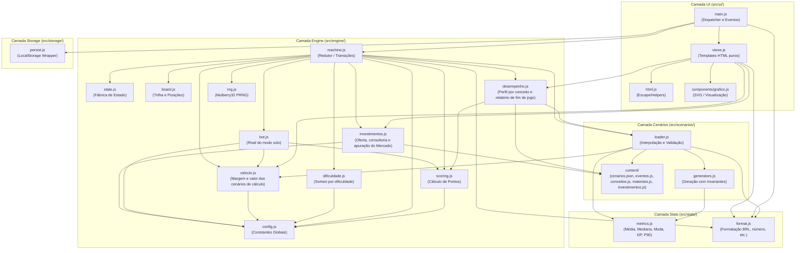
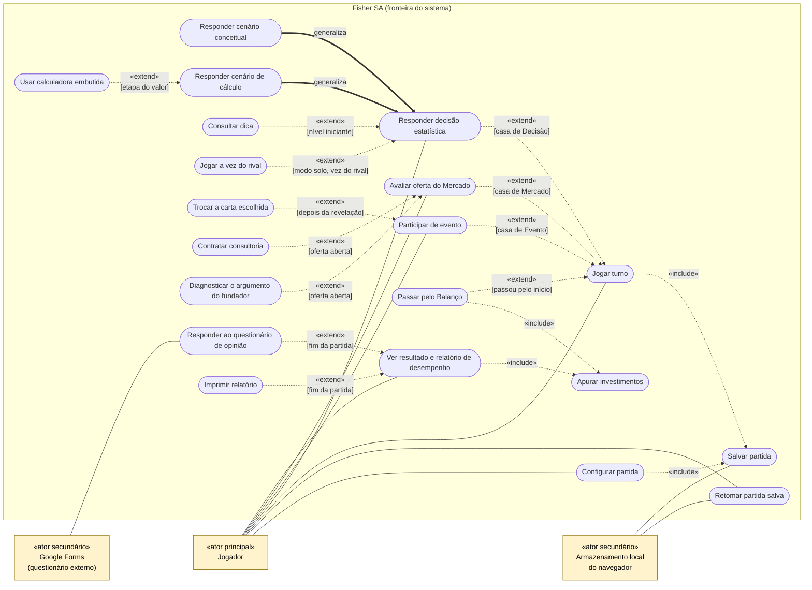
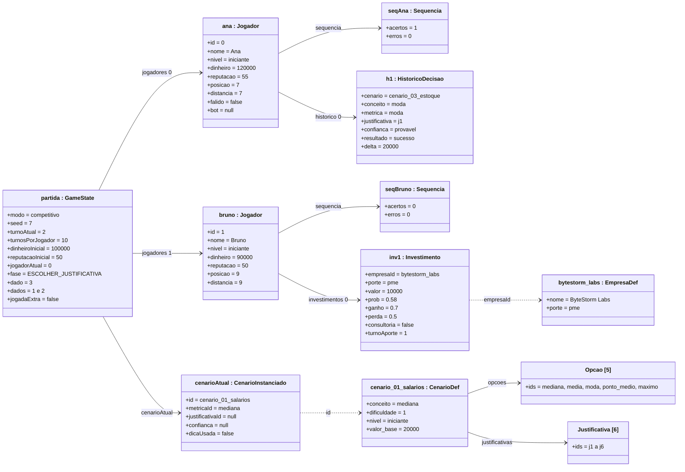
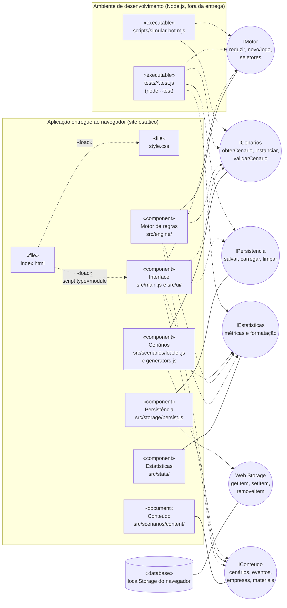
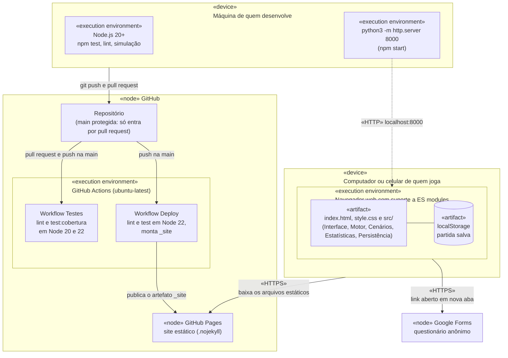

# Documentação Arquitetural e Diagramas UML - Fisher SA

Este documento consolida a modelagem UML e arquitetural do projeto **Fisher SA**, detalhando sua estrutura de dados, máquina de estados, ciclo de vida de execução e separação em camadas.

Os diagramas seguem a notação UML das aulas de Análise e Projeto de Sistemas (pasta `diagramas/`) e estão escritos em Mermaid, para renderizar direto no GitHub:

| Seção | Diagrama | Visão |
| :--- | :--- | :--- |
| 1 | Classes e entidades | Estrutural |
| 2 | Máquina de estados | Comportamental |
| 3 | Sequência | Comportamental |
| 4 | Pacotes e arquitetura (módulos) | Arquitetura lógica |
| 5 | Casos de uso | Requisitos |
| 6 | Objetos (instantâneo de uma partida) | Estrutural |
| 7 | Atividades (turno, decisão e configuração) | Comportamental |
| 8 | Componentes e implantação | Arquitetura física |
| 9 | Descrição dos componentes | Referência |

O Mermaid não tem diagramas nativos de casos de uso, objetos, atividades, componentes e implantação. Nas seções 5 a 8 eles são desenhados com `flowchart` ou `classDiagram` e estereótipos entre «», como explicado no início de cada seção.

---

## 1. Diagrama de Classes e Entidades (Estrutural)

Modela o estado da partida, as entidades de negócio (jogadores, cenários, cartas de evento) e os serviços/módulos do sistema.

```mermaid
classDiagram
    direction TB

    class GameState {
        +int versao
        +int seed
        +int rng
        +int turnoAtual
        +int turnosPorJogador
        +int dinheiroInicial
        +int reputacaoInicial
        +boolean falencia
        +int jogadorAtual
        +Fase fase
        +int dado
        +int[] dados
        +boolean jogadaExtra
        +Balanco balanco
        +List~Jogador~ jogadores
        +List~string~ baralhoCenarios
        +List~string~ baralhoEventos
        +Object baralhoInvestimentos
        +CenarioInstanciado cenarioAtual
        +EventoAtual eventoAtual
        +OfertaMercado mercadoAtual
        +List~ApuracaoFinal~ apuracaoFinal
        +Resultado resultado
        +Teste teste
        +boolean soConceitual
    }

    class Jogador {
        +int id
        +string nome
        +boolean falido
        +boolean negativado
        +Sequencia sequencia
        +Nivel nivel
        +number dinheiro
        +number reputacao
        +int posicao
        +int distancia
        +List~HistoricoDecisao~ historico
        +List~Investimento~ investimentos
        +PerfilBot bot
    }

    class Sequencia {
        +int erros
        +int acertos
    }

    class HistoricoDecisao {
        +string cenario
        +string conceito
        +string metrica
        +string justificativa
        +Confianca confianca
        +CategoriaResultado resultado
        +number delta
        +List~string~ equivocos
        +number valor
        +boolean valorCorreto
    }

    class CenarioDef {
        +string id
        +int versao
        +string tipo
        +Object calculo
        +string idioma
        +Nivel nivel
        +int dificuldade
        +string conceito
        +string titulo
        +string contexto
        +string dica
        +number valor_base
        +DadosCenario dados
        +List~Opcao~ opcoes
        +List~Justificativa~ justificativas
        +Feedback feedback
    }

    class Opcao {
        +string id
        +string chave
        +string texto
        +boolean correta
        +string equivoco
    }

    class Justificativa {
        +string id
        +string texto
        +TipoJustificativa tipo
        +string equivoco
    }

    class EventoCarta {
        +string id
        +TipoCarta tipo
        +string setor
        +string titulo
        +string texto
        +string licao
        +number dinheiro
        +number reputacao
    }

    class TipoCarta {
        <<enumeration>>
        boa
        ruim
        troll
    }

    class DecisaoEvento {
        <<enumeration>>
        null
        escolhendo
        trocando
        participou
        recusou
    }

    class EventoAtual {
        +string[] cartas
        +DecisaoEvento decisao
        +int primeira
        +int revelada
        +int escolhida
        +boolean trocou
        +string id
        +boolean crise
        +int dinheiro
    }

    class Investimento {
        +string empresaId
        +string nome
        +Porte porte
        +int valor
        +number prob
        +number ganho
        +number perda
        +boolean consultoria
        +int honorario
        +int turnoAporte
    }

    class OfertaMercado {
        +string empresaId
        +Porte porte
        +number prob
        +number ganho
        +number perda
        +boolean consultoria
        +string diagnostico
        +Analise analise
        +int aporte
        +string decisao
        +int honorarioPago
    }

    class EmpresaDef {
        +string id
        +Porte porte
        +string nome
        +string setor
        +string tempo
        +string fundador
        +int[] historico
        +number prob
        +number ganho
        +number perda
        +Falacia falha
        +string explicacao
        +string sucesso
        +string fracasso
    }

    class InvestimentosService {
        +porteDaReputacao(reputacao) Porte
        +valorEsperado(oferta) number
        +ganhoComConsultoria(ganho) number
        +sortearOferta(e, reputacao, rng) OfertaMercado
        +liquidar(investimento, rng) ResultadoInvestimento
        +liquidarTodos(carteira, jogador, rng) List
        +totalInvestido(jogador) number
    }

    class RngService {
        +int estado
        +prox() number
        +entre(min, max) number
        +inteiro(min, max) int
        +normal(media, dp) number
        +embaralhar(lista) Array
    }

    class BotService {
        +acertoEfetivo(perfil, dificuldade) number
        +confiancaDaCerteza(certeza) Confianca
        +decidirBot(def, perfil, rng, num) Escolha
    }

    class CalculoService {
        +ehCalculo(def) boolean
        +margemPct(esperado) number
        +avaliarCalculo(opcao, num, informado) AvaliacaoCalculo
        +valorEsperado(def, cenarioAtual) number
        +notaDeMetodo(chave) string
        +calcularOperacao(valores, id, p) number
        +formatarResultadoCalculadora(r) string
    }

    class DificuldadeService {
        +dificuldadeAlvo(progresso) number
        +pesoDificuldade(dificuldade, progresso) number
        +escolherPorDificuldade(candidatos, progresso, rng) string
    }

    class ScoringEngine {
        +multiplicadorReputacao(reputacao) number
        +justificativaConta(tipo) boolean
        +fatorSequencia(sequencia) number
        +multiplicadorSequencia(categoria, sequencia) number
        +atualizarSequencia(categoria, sequencia) Sequencia
        +classificar(metricaCorreta, justCorreta) CategoriaResultado
        +resolverDecisao(params) ResultadoDecisao
        +receitaBalanco(reputacao) number
    }

    class BoardService {
        +Array~string~ CASAS
        +int NUM_CASAS
        +avancar(posicao, passos) Object
        +coordenadas(i, colunas, linhas) Object
    }

    class ScenarioLoader {
        +obterCenario(id) CenarioDef
        +instanciar(def, rng) Object
        +validarCenario(def, rng) List
        +preencher(texto, vars) string
    }

    class StorageService {
        +salvar(estado) void
        +carregar() GameState
        +limpar() void
    }

    GameState "1" *-- "1..3" Jogador : contém
    Jogador "1" *-- "*" HistoricoDecisao : registra
    Jogador "1" *-- "1" Sequencia : acumula
    Jogador "1" *-- "*" Investimento : mantém em custódia até o Balanço
    GameState "1" o-- "0..1" CenarioDef : executa em 'decisao'
    GameState "1" o-- "0..1" EventoAtual : apresenta em 'evento'
    EventoAtual "1" ..> "3" EventoCarta : mão sorteada (uma boa, uma ruim, uma troll)
    GameState "1" o-- "0..1" OfertaMercado : apresenta em 'mercado'
    OfertaMercado "1" ..> "1" EmpresaDef : sorteada do catálogo
    CenarioDef "1" *-- "5" Opcao : possui
    CenarioDef "1" *-- "6..8" Justificativa : possui
    
    GameState ..> RngService : utiliza seed/estado
    GameState ..> BoardService : consulta trilha
    GameState ..> DificuldadeService : sorteia cenário por progresso
    GameState ..> BotService : decide a vez do rival (modo solo)
    GameState ..> CalculoService : confere o valor dos cenários de cálculo
    GameState ..> InvestimentosService : oferece e apura investimentos
    InvestimentosService ..> RngService : sorteia a oferta e o desfecho
    BotService ..> CalculoService : informa o valor no cenário de cálculo
    ScenarioLoader ..> CenarioDef : gerencia/instancia
    ScoringEngine <.. GameState : calcula pontuação
    StorageService ..> GameState : serializa/deserializa
```



---

## 2. Diagrama de Máquina de Estados (Comportamental)

Modela o fluxo de fases do motor de turnos em `src/engine/machine.js`. Cada transição é uma função pura `(estado, acao) -> novoEstado`.

```mermaid
stateDiagram-v2
    [*] --> MENU : Início / Sem jogo ativo
    
    MENU --> ROLAR_DADO : NOVA partida / CONTINUAR_SALVA
    
    state TurnoAtivo {
        [*] --> ROLAR_DADO
        
        ROLAR_DADO --> ESCOLHER_METRICA : ROLAR (caiu em 'decisao')
        ROLAR_DADO --> MOSTRAR_EVENTO : ROLAR (caiu em 'evento')
        ROLAR_DADO --> MOSTRAR_MERCADO : ROLAR (caiu em 'mercado')
        ROLAR_DADO --> MOSTRAR_BALANCO : ROLAR (caiu em 'balanco')
        
        state FluxoDecisao {
            ESCOLHER_METRICA --> ESCOLHER_METRICA : ABRIR_DICA (só iniciante; marca dicaUsada e reduz o bônus de confiança)
            ESCOLHER_METRICA --> ESCOLHER_JUSTIFICATIVA : METRICA(id) (só pessoa, cenário comum)
            ESCOLHER_METRICA --> INFORMAR_VALOR : METRICA(id) (só pessoa, cenário de cálculo)
            INFORMAR_VALOR --> ESCOLHER_JUSTIFICATIVA : VALOR(número ou texto pt-BR)
            ESCOLHER_METRICA --> MOSTRAR_RESULTADO : DECIDIR_BOT (só rival do modo solo)
            ESCOLHER_JUSTIFICATIVA --> ESCOLHER_CONFIANCA : JUSTIFICATIVA(id)
            ESCOLHER_CONFIANCA --> MOSTRAR_RESULTADO : CONFIANCA('chute' | 'duvida' | 'provavel' | 'confiante' | 'certeza')
        }
        
        state FluxoEvento {
            MOSTRAR_EVENTO --> MOSTRAR_EVENTO : PARTICIPAR (decisao = escolhendo; três cartas viradas)
            MOSTRAR_EVENTO --> MOSTRAR_EVENTO : ESCOLHER_CARTA(0, 1 ou 2) (revela uma das outras, nunca a boa; decisao = trocando)
            MOSTRAR_EVENTO --> MOSTRAR_EVENTO : MANTER / TROCAR (aplica o efeito da carta final; decisao = participou)
        }

        state FluxoMercado {
            MOSTRAR_MERCADO --> MOSTRAR_MERCADO : ABRIR_CONSULTORIA / DIAGNOSTICAR(falácia) (oferta aberta, uma vez cada)
            MOSTRAR_MERCADO --> MOSTRAR_MERCADO : INVESTIR(aporte) / RECUSAR (fecha a oferta, paga o diagnóstico e, se contratou a consultoria sem investir, debita o honorário)
        }

        MOSTRAR_RESULTADO --> ValidaFimTurno : CONTINUAR
        MOSTRAR_EVENTO --> ValidaFimTurno : RECUSAR (passa a vez, sem efeito) / CONTINUAR (sem decidir vale RECUSAR; com as cartas na mesa ou à espera de manter ou trocar é ignorado; depois de decidir, segue)
        MOSTRAR_MERCADO --> ValidaFimTurno : CONTINUAR (sem decidir, vale RECUSAR)
        MOSTRAR_BALANCO --> ValidaFimTurno : CONTINUAR
        
        state ValidaFimTurno <<choice>>
        ValidaFimTurno --> ROLAR_DADO : dados iguais e jogador no jogo\n(mesmo jogador, jogadaExtra, sem gastar trimestre)
        ValidaFimTurno --> ROLAR_DADO : turnoAtual <= turnosPorJogador\n(próximo jogador que não faliu ou nova rodada)
    }

    ValidaFimTurno --> FIM_DE_JOGO : turnoAtual > turnosPorJogador\n(apura os investimentos em custódia)\nou empresa falida (coop.)\nou só um jogador sem falir
    FIM_DE_JOGO --> MENU : NOVA partida (limpa storage)
```

---

## 3. Diagrama de Sequência (Comportamental)

Demonstra a ordem de chamada e a comunicação assíncrona/reativa orientada por eventos desde a interação na interface até a persistência no armazenamento.

```mermaid
sequenceDiagram
    autonumber
    actor Jogador as Jogador (User)
    participant UI as UI (main.js / views.js)
    participant Machine as Engine (machine.js)
    participant RNG as RNG (rng.js)
    participant Board as Board (board.js)
    participant Loader as ScenarioLoader (loader.js)
    participant Scoring as Scoring (scoring.js)
    participant Invest as Investimentos (investimentos.js)
    participant Storage as Persist (persist.js)

    Jogador->>UI: Clica em "Jogar" no centro do tabuleiro (data-acao="ROLAR")
    UI->>Machine: reduzir(estado, { tipo: 'ROLAR' })
    activate Machine
    Machine->>RNG: inteiro(1, 6)
    RNG-->>Machine: d1 (ex: 4)
    Machine->>RNG: inteiro(1, 6)
    RNG-->>Machine: d2 (ex: 3)
    Note over Machine: dado = d1 + d2
    Machine->>Board: avancar(j.posicao, dado)
    Board-->>Machine: { posicao, passouInicio }
    
    alt Passou pelo início
        Machine->>Scoring: receitaBalanco(reputacao)
        Scoring-->>Machine: receita
        Note over Machine: Aplica balanço financeiro
        Machine->>Invest: liquidarTodos(carteira, jogador, rng)
        Invest->>RNG: prox() (um sorteio por aporte)
        Invest-->>Machine: retornos dos investimentos (creditados antes da meta e da falência)
    end

    Note over Machine: distancia += dado; progresso = distancia / (turnos × 7)

    alt Casa == 'decisao'
        Machine->>Machine: sacarCenario (peso por dificuldade vs. progresso)
        Machine->>Loader: instanciar(obterCenario(id), rng)
        Loader-->>Machine: { series, num, vars }
        Note over Machine: fase = 'ESCOLHER_METRICA'
    else Casa == 'evento'
        Machine->>RNG: sacarMao (uma carta boa, uma ruim e uma troll, em posições embaralhadas)
        Note over Machine: fase = 'MOSTRAR_EVENTO' (decisao = null, sem efeito até a pessoa escolher uma carta)
    else Casa == 'mercado'
        Machine->>Invest: sortearOferta(e, reputacao, rng)
        Invest-->>Machine: oferta (empresa do porte e chance sorteada)
        Note over Machine: fase = 'MOSTRAR_MERCADO' (a chance fica oculta até a consultoria)
    else Casa == 'balanco'
        Note over Machine: fase = 'MOSTRAR_BALANCO'
    end
    
    Machine-->>UI: novoEstado
    deactivate Machine
    
    opt Vez do rival (modo solo) e fase 'ESCOLHER_METRICA'
        UI->>Machine: reduzir(estado, { tipo: 'DECIDIR_BOT' })
        Machine->>Machine: decidirBot(def, perfil, rng, num) e pontua como uma pessoa
        Machine-->>UI: novoEstado (fase: 'MOSTRAR_RESULTADO')
    end

    UI->>Storage: salvar(novoEstado)
    UI->>UI: render()
    
    Note over Jogador, UI: O Jogador seleciona Métrica -> (Valor calculado, só em cenário de cálculo) -> Justificativa -> Confiança
    Jogador->>UI: Confirma Confiança ("certeza")
    UI->>Machine: reduzir(estado, { tipo: 'CONFIANCA', valor: 'certeza' })
    activate Machine
    Machine->>Scoring: resolverDecisao(params)
    Scoring-->>Machine: { delta, deltaReputacao, categoria, ... }
    Machine-->>UI: novoEstado (fase: 'MOSTRAR_RESULTADO')
    deactivate Machine
    
    UI->>Storage: salvar(novoEstado)
    UI->>UI: render()
```

---

## 4. Diagrama de Pacotes e Arquitetura (Módulos)

Apresenta as camadas do projeto e a direção das dependências entre módulos ES6:



---

## 5. Diagrama de Casos de Uso (Requisitos)

Mostra a visão externa do sistema: o que o **Fisher SA** oferece e a quem, sem dizer como (o "como" está nos diagramas de sequência, atividades e estados). Segue a Aula 04: atores fora da fronteira do sistema, casos de uso dentro dela, e os relacionamentos de **generalização**, **inclusão** (`«include»`) e **extensão** (`«extend»`).

> **Notação.** O Mermaid não tem diagrama de casos de uso nativo, então este usa `flowchart`: retângulos com `«estereótipo»` são atores, elipses são casos de uso, a moldura `Fisher SA` é a fronteira do sistema, linha contínua sem seta é associação, seta tracejada é `«include»` (da base para o incluído) ou `«extend»` (da extensão para a base) e seta grossa "generaliza" aponta do caso especializado para o geral.



**Atores.**

| Ator | Tipo | Papel |
| :--- | :--- | :--- |
| **Jogador** | Principal | Pessoa de 1 a 3 que joga em hot-seat no mesmo dispositivo. Nos três modos (competitivo, cooperativo e solo) é o mesmo ator; o modo só muda as regras do caso de uso, não quem o executa. |
| **Armazenamento local do navegador** | Secundário | `localStorage`, onde a partida é gravada a cada transição e de onde é retomada. Se estiver indisponível, o jogo segue sem salvar. |
| **Google Forms** | Secundário | Serviço externo do questionário anônimo (`URL_PESQUISA`), aberto em nova aba. O jogo não sabe se foi respondido. |

O **rival do modo solo** não é ator: é comportamento interno do sistema (`bot.js`), por isso aparece como o caso de uso `Jogar a vez do rival`, e não como uma pessoa fora da fronteira.

**Pontos de extensão de `Jogar turno`.** A casa onde o peão cai decide qual extensão roda: Decisão, Evento, Mercado ou Balanço (`fisher.md` 3.1 e 3.2). O Balanço também roda quando o peão apenas **passa** pelo início, antes de resolver a casa onde parou.

**Descrição do caso de uso `Responder decisão estatística`** (`fisher.md` 3.3 a 3.5 e 4.7):

| Item | Descrição |
| :--- | :--- |
| Ator | Jogador (no modo solo, também o rival, decidido pelo sistema) |
| Pré-condição | O peão caiu numa casa de Decisão e a fase é `ESCOLHER_METRICA`. |
| Fluxo principal | 1. O sistema sorteia um cenário do baralho, com peso pela dificuldade-alvo do progresso, e mostra o contexto e os dados (gráfico ou tabela). 2. O jogador escolhe a **métrica**. 3. O jogador escolhe a **justificativa**. 4. O jogador escolhe a **confiança** (de `chute` a `certeza`). 5. O sistema classifica a resposta (sucesso, sorte, incoerência ou erro total), atualiza caixa, reputação e sequência, registra no histórico e salva. 6. O sistema mostra o resultado e a explicação, e o jogador continua. |
| Variante: cenário de cálculo | Entre 2 e 3 há o passo **informar o valor**; a métrica só conta como certa se a opção estiver certa **e** o valor estiver dentro da margem. O jogador pode usar a calculadora embutida (`Usar calculadora embutida`). |
| Variante: dica | No nível iniciante, antes da métrica, o jogador pode abrir a dica (`ABRIR_DICA`), o que reduz o bônus de confiança. |
| Variante: modo solo | Na vez do rival o sistema executa tudo numa só ação (`DECIDIR_BOT`) e o jogador vê direto o resultado. |
| Fluxo excepcional | Valor que não é número: o sistema mostra o erro no campo e não avança. Armazenamento indisponível: o jogo continua e não retoma depois. Caixa negativo ao continuar numa jogada que passou pelo Balanço: o sistema aplica a falência (`fisher.md` 3.12). |
| Pós-condição | A fase é `MOSTRAR_RESULTADO` e a decisão está no histórico do jogador. |

---

## 6. Diagrama de Objetos (Instantâneo de uma Partida)

Uma "fotografia" de uma partida em execução, com valores concretos nos atributos e os vínculos entre os objetos (Aula 06). Complementa o diagrama de classes da seção 1: cada objeto aqui é instância de uma daquelas classes. Mostra só os objetos necessários para entender o momento, não o estado inteiro.

**Momento retratado.** Partida competitiva de dois jogadores, semente 7, 10 trimestres. No 2º trimestre, **Ana** rolou 1 + 2, caiu na casa 7 (Decisão), recebeu o cenário *Política salarial na startup* e já escolheu a métrica "mediana"; falta a justificativa. No 1º trimestre ela tinha acertado o cenário do estoque de calçados com confiança `provavel` (+R$ 20.000, +5 de reputação). **Bruno** caiu na casa 9 (Mercado) e aportou R$ 10.000 numa empresa de porte PME, ainda em custódia até o próximo Balanço.

> **Notação.** O Mermaid não tem diagrama de objetos nativo, então este usa `classDiagram`: cada caixa é um objeto, rotulada `nome : Classe` (sem o sublinhado da UML), e os atributos mostram valores com `=`. Objetos anônimos aparecem como `: Classe`. A caixa `Opcao [5]` é um *multiobject* (conjunto de objetos com o mesmo papel).



Leitura rápida: `partida.jogadorAtual = 0` aponta para `ana`; `ana.posicao = 7` é uma casa de Decisão (`CASAS[7]`), por isso `partida.cenarioAtual` existe; `bruno.investimentos` guarda o aporte até ele passar pelo Balanço, quando `liquidar` sorteia o desfecho com `inv1.prob`. Num jogo solo, `bruno` seria um `Jogador` com `bot = medio` e `investimentos` sempre vazio. O diagrama não mostra a evolução no tempo; para isso, ver as seções 2, 3 e 7.

---

## 7. Diagramas de Atividades (Fluxos)

Decompõem os fluxos de trabalho em atividades, decisões e raias de responsabilidade (Aula 08). O jogo é de uma só linha de execução (um jogador por vez, sem concorrência), então **não há `fork`/`join`**: os fluxos são sequenciais com ramificações. Os estados internos de cada fase estão no diagrama da seção 2.

> **Notação.** O Mermaid não tem diagrama de atividades nativo, então usa-se `flowchart`: círculo cheio é o estado inicial, círculo duplo é o final, retângulo arredondado é atividade, losango é decisão (com as condições entre colchetes nas setas) e cada `subgraph` é uma raia (*swimlane*).

### 7.1 Turno de um jogador (com raias)

```mermaid
flowchart TB
    ini((" ")):::ini
    fin(((" "))):::fin

    subgraph RJ["Raia: Jogador"]
        J1("Clicar em Jogar")
        J2("Resolver a casa: responder a decisão,<br/>escolher a carta, decidir o aporte<br/>ou apenas ler o Balanço")
        J3("Clicar em Continuar")
    end

    subgraph RU["Raia: Interface (main.js / views.js)"]
        U1("Despachar ROLAR")
        UR{"Decisão na vez<br/>do rival (modo solo)?"}
        UB("Despachar DECIDIR_BOT")
        U2("Mostrar a fase no painel<br/>sobre o tabuleiro (render)")
        U3("Despachar as ações da fase")
        U4("Mostrar o resultado e a explicação")
        U5("Despachar CONTINUAR")
        U6("Mostrar o questionário de opinião<br/>e depois o resultado final")
    end

    subgraph RM["Raia: Motor (machine.js)"]
        M1("Rolar dois dados e<br/>mover o peão")
        M2{"Passou pelo<br/>início?"}
        M3("Aplicar o Balanço e<br/>apurar os investimentos")
        M4{"Tipo da casa"}
        M5("Sacar e instanciar<br/>o cenário")
        M6("Sacar a mão de<br/>três cartas")
        M7("Sortear a oferta<br/>de investimento")
        M8("Mostrar o Balanço")
        M9("Aplicar o efeito:<br/>caixa, reputação, sequência<br/>e histórico")
        M10{"A falência encerra a partida?<br/>(empresa falida, ninguém no jogo<br/>ou um só sobrevivente)"}
        M11{"Dados iguais e<br/>jogador ainda no jogo?"}
        M12("Mesmo jogador joga de novo,<br/>sem gastar trimestre")
        M13("Passar a vez ao próximo<br/>jogador que não faliu")
        M14{"Trimestres<br/>esgotados?"}
        M15("Apurar os investimentos<br/>em custódia")
        M16("Fase FIM_DE_JOGO")
    end

    subgraph RS["Raia: Armazenamento (persist.js)"]
        S1("salvar(estado)")
        S2("salvar(estado)")
        S3("salvar(estado)")
        S4("limpar()<br/>apaga a partida salva")
    end

    ini --> J1 --> U1 --> M1 --> M2
    M2 -->|"sim"| M3 --> M4
    M2 -->|"não"| M4
    M4 -->|"Decisão"| M5 --> UR
    M4 -->|"Evento"| M6 --> S1
    M4 -->|"Mercado"| M7 --> S1
    M4 -->|"Balanço"| M8 --> S1
    UR -->|"não"| S1
    UR -->|"sim"| UB --> M9
    S1 --> U2 --> J2 --> U3 --> M9 --> S2 --> U4 --> J3 --> U5 --> M10
    M10 -->|"sim"| M16
    M10 -->|"não"| M11
    M11 -->|"sim"| M12 --> S3
    M11 -->|"não"| M13 --> M14
    M14 -->|"não"| S3
    M14 -->|"sim"| M15 --> M16
    S3 --> J1
    M16 --> S4 --> U6 --> fin

    classDef ini fill:#000,stroke:#000
    classDef fin fill:#fff,stroke:#000,stroke-width:3px
```



Observações:

- A atividade `Resolver a casa` tem várias etapas e várias gravações (uma por transição); aqui está colapsada, como recomenda a Aula 08 para ações complicadas. A decisão é detalhada em 7.2.
- O Evento e o Mercado têm seus próprios subfluxos (participar, escolher e trocar a carta; consultoria, diagnóstico, investir ou recusar), descritos nas máquinas `FluxoEvento` e `FluxoMercado` da seção 2.
- Em `CONTINUAR` a ordem é: falência (só na jogada que passou pelo Balanço, com o caixa já final, `fisher.md` 3.12), jogada extra por dados iguais, passagem da vez e, por fim, o teste de trimestres esgotados. Só o fim por trimestres apura os investimentos em custódia; a falência da empresa ou a vitória do último sobrevivente encerram a partida sem apuração.
- O rival do solo não participa de Evento nem investe no Mercado: nessas casas ele só passa a vez.

### 7.2 Decisão estatística

```mermaid
flowchart TB
    ini((" ")):::ini
    fin(((" "))):::fin

    A("Mostrar o cenário: contexto,<br/>gráfico ou tabela")
    B{"Quem decide?"}
    BOT("DECIDIR_BOT: o rival escolhe métrica,<br/>valor (se for cálculo), justificativa<br/>e confiança")
    D{"Abrir a dica?<br/>(só nível iniciante)"}
    D1("ABRIR_DICA: marca dicaUsada e<br/>reduz o bônus de confiança")
    C("Escolher a métrica")
    E{"Cenário de<br/>cálculo?"}
    F("Informar o valor calculado<br/>(pode usar a calculadora embutida)")
    G{"O valor é um<br/>número?"}
    G1("Mostrar o erro no campo")
    H("Escolher a justificativa")
    I("Escolher a confiança:<br/>chute, dúvida, provável,<br/>confiante ou certeza")
    R("Classificar: sucesso, sorte,<br/>incoerência ou erro total")
    T("Atualizar caixa, reputação,<br/>sequência e histórico")
    V("Mostrar resultado e explicação<br/>(MOSTRAR_RESULTADO)")

    ini --> A --> B
    B -->|"pessoa"| D
    B -->|"rival do modo solo"| BOT --> R
    D -->|"sim"| D1 --> C
    D -->|"não"| C
    C --> E
    E -->|"sim"| F --> G
    G -->|"não"| G1 --> F
    G -->|"sim"| H
    E -->|"não"| H
    H --> I --> R --> T --> V --> fin

    classDef ini fill:#000,stroke:#000
    classDef fin fill:#fff,stroke:#000,stroke-width:3px
```



Em cenário de cálculo a métrica só conta como certa se a opção estiver certa **e** o valor estiver dentro da margem; o valor é conferido contra a métrica escolhida (`fisher.md` 4.7).

### 7.3 Configuração da partida (assistente da tela inicial)

```mermaid
flowchart TB
    ini((" ")):::ini
    fin(((" "))):::fin

    T0("Mostrar a tela inicial<br/>com a introdução")
    T1{"Escolha do jogador"}
    T2("CONTINUAR_SALVA: carregar()<br/>e mostrar a partida")
    T3("Abrir o assistente<br/>(janela Anterior / Próximo)")
    E("Mostrar a etapa atual")
    P("Clicar em Próximo")
    V{"Campos da etapa<br/>válidos?"}
    A("Mostrar o aviso do campo")
    N{"Era a última<br/>etapa?"}
    I("Clicar em Iniciar Disputa Corporativa:<br/>novoJogo(config) limita os valores")
    S("salvar(estado) e<br/>mostrar o tabuleiro")

    ini --> T0 --> T1
    T1 -->|"Continuar partida salva<br/>(só se houver save)"| T2 --> fin
    T1 -->|"Iniciar"| T3 --> E
    E -->|"Anterior"| E
    E --> P --> V
    V -->|"não"| A --> E
    V -->|"sim"| N
    N -->|"não: próxima etapa"| E
    N -->|"sim"| I --> S --> fin

    classDef ini fill:#000,stroke:#000
    classDef fin fill:#fff,stroke:#000,stroke-width:3px
```



Ordem das etapas: **história** (a crise dos "achismos"), **a disputa pelo controle acionário**, **como prosperar perante o Conselho**, **modo de jogo**, **participantes** (quantidade e, no solo, o rival), **um jogador por etapa** (nome, perfil e setor; as etapas de jogadores que não existem na partida são puladas), **duração**, **capital inicial** (caixa e reputação), **mercado** (semente) e **material de apoio**. Só a última etapa mostra o botão Iniciar; **Esc** fecha o assistente em qualquer etapa e volta à tela inicial, sem criar a partida. A validação roda a cada Próximo (`checkValidity`), então uma etapa inválida não avança.

---

## 8. Arquitetura Física: Componentes e Implantação

Complementa o diagrama de pacotes da seção 4, que mostra a estrutura **lógica** (camadas e dependências entre módulos), com a estrutura **física** (o que é entregue e como se liga) e o ambiente onde roda (Aula 10). Os dois seguem o estilo arquitetônico do projeto: site estático, ES modules sem bundler, sem backend (ADRs 0001, 0002 e 0005).

### 8.1 Diagrama de Componentes

Cada componente agrupa os módulos de uma camada da seção 4 e é ligado aos outros por **interfaces**: o círculo é a interface; a linha contínua liga o componente que a **realiza** (exporta) e a seta tracejada parte de quem a **usa** (importa). Quem usa depende só da interface, não do interior do componente.

> **Notação.** O Mermaid não tem diagrama de componentes nativo, então usa-se `flowchart`: retângulos com `«estereótipo»` (`«component»`, `«file»`, `«document»`, `«executable»`, `«database»`) e círculos para as interfaces.



Pontos de leitura:

- **Substituição.** O componente de persistência pode ser trocado por outro que realize `IPersistencia` (por exemplo, `sessionStorage` ou um arquivo) sem mudar a Interface nem o Motor. O mesmo vale para o Motor, que não conhece a Interface: é uma função pura `(estado, ação) → novoEstado` (ADR 0003).
- **Sentido das dependências.** O Motor não usa `IPersistencia` nem a Interface; só a Interface grava e lê a partida. Isso é o que permite testar o Motor e simular partidas sem navegador.
- **Conteúdo como dado.** Os cenários são dados (`cenarios.json`), não código (ADR 0006); o Motor, a Interface e o componente de Cenários só os leem pela interface `IConteudo`.
- **Fora do diagrama.** `scripts/lint.mjs` lê todos os arquivos de `src/` e `tests/` pelo sistema de arquivos e não depende de nenhuma interface; os workflows do GitHub Actions aparecem na implantação (8.2).

### 8.2 Diagrama de Implantação

Mostra os nós onde os componentes executam e as conexões entre eles. **Em produção só há dois nós de execução: o navegador de quem joga e o site estático do GitHub Pages.** Depois que os arquivos são baixados, todo o processamento (regras, sorteios, pontuação e gravação da partida) acontece no navegador, sem servidor de aplicação nem banco de dados (`fisher.md` 5.10).

> **Notação.** O Mermaid não tem diagrama de implantação nativo, então usa-se `flowchart` com subgrafos para os nós (`«device»`, `«execution environment»`) e estereótipos nas conexões para o protocolo (`«HTTPS»`).



**Estrangulamentos (Aula 10).** Não há gargalo de servidor: o custo por jogador é zero no lado do host, e a capacidade é a do CDN do GitHub Pages para arquivos estáticos. Os limites reais são do cliente: o tamanho do `localStorage` (a partida salva é um JSON pequeno) e o suporte a ES modules. O envio ao Google Forms acontece fora do jogo, na aba que a pessoa abre; falha nele não afeta a partida.

---

## 9. Descrição dos Componentes Principais

| Módulo | Responsabilidade Principal |
| :--- | :--- |
| **`src/engine/machine.js`** | Máquina de estados finitos que orquestra as transições a partir de ações do jogador. |
| **`src/engine/state.js`** | Fábrica inicial do estado (`novoJogo`, que aceita `turnos` (1 a 64), `dinheiroInicial` (R$ 10.000 a R$ 1.000.000) e `reputacaoInicial` (10 a 100), todos limitados, e `soConceitual`, para excluir os cenários de cálculo, e os atalhos de teste do menu: casa forçada e baralho restrito, ver `fisher.md` 5.8.1) e `diretoria` e `papeis` por jogador (a partir da escolha de setor no menu; `atribuirPapeis(n, escolhas)` em `papeis.js`) e funções seletoras puras (`jogadorAtual`, `dinheiroInicialDe`, `ehBot`, `ehFalido`, `empresaFalida`, `jogadoresAtivos`, `classificacao`, `vencedores`, `progressoDoJogador`). Falência (`fisher.md` 3.12): `continuar` em `machine.js` marca `falido` (ou `falencia` no cooperativo) quando o caixa fecha negativo uma jogada que passou pelo Balanço; `julgarBalanco` (em `state.js`) decide quem perde entre os negativados, adiando o veredito se um rival com saldo pior ainda não passou pelo Balanço; `classificacao` e `vencedores` põem o falido por último. |
| **`src/engine/bot.js`** | Rival do modo solo: acerta métrica e justificativa com a probabilidade do perfil (menor nos cenários difíceis), escolhe distratores ao errar e deriva a confiança de uma certeza interna ruidosa. Perfis em `config.js`, calibração em `scripts/simular-bot.mjs` (`fisher.md` 3.11). |
| **`src/engine/investimentos.js`** | Investimentos do Mercado (`fisher.md` 3.14): porte da empresa pela reputação (`porteDaReputacao`), oferta sem repetir no ciclo e com a chance de sucesso sorteada em torno da do catálogo (`sortearOferta`), retorno com a penalidade da consultoria (`ganhoComConsultoria`), valor esperado, sorteio do desfecho e crédito de cada aporte (`liquidar`, `liquidarTodos`) e o total em custódia. A máquina o chama ao cair no Mercado, no Balanço e no fim da partida; as empresas ficam em `scenarios/content/investimentos.js`. |
| **`src/engine/machine.js` (Eventos)** | Casa de Evento (`fisher.md` 3.15): `sacarMao` tira uma carta de cada tipo (`boa`, `ruim`, `troll`) do `baralhoEventos`, que não repete carta dentro do ciclo de cada tipo, e as embaralha; `PARTICIPAR` põe as cartas na mesa, `ESCOLHER_CARTA` registra a primeira escolha e revela uma das outras, nunca a boa (`cartaParaRevelar`, que só usa o rng da partida quando a escolhida é a boa), `MANTER` ou `TROCAR` aplicam o efeito da carta final (`revelarCarta`, com o amortecimento do cooperativo e a crise de imagem) e `RECUSAR` passa a vez. O rival do solo passa sem participar. As cartas ficam em `scenarios/content/eventos.js`. |
| **`src/engine/dificuldade.js`** | Dificuldade-alvo a partir do progresso do jogador e sorteio ponderado de cenários do baralho. |
| **`src/engine/rng.js`** | Gerador pseudo-aleatório determinístico baseado no algoritmo `mulberry32` com estado serializável em 32-bits. |
| **`src/engine/desempenho.js`** | Perfil de desempenho do jogador a partir do histórico: domínio e diagnóstico por conceito, pontos fortes, deficiências, equívocos recorrentes e calibração da certeza; e o relatório de fim de jogo (`relatorioDesempenho`): acertos e erros, assuntos que mais e menos domina e sugestões de estudo com os materiais de `content/materiais.js` (`fisher.md` 4.6). |
| **`src/engine/calculo.js`** | Cenários de cálculo (`fisher.md` 4.7): reconhece o tipo, avalia o valor informado contra o valor exato da métrica escolhida dentro de uma margem relativa (5% abaixo de 100, 2% a partir de 100) e fornece as notas de método (percentil linear, desvio padrão amostral) e as operações da calculadora embutida na etapa do valor (`calcularOperacao`, que não altera o estado). |
| **`src/engine/scoring.js`** | Algoritmos de pontuação, multiplicadores de reputação e de sequência (fator de erros e acertos seguidos), regras de aposta e crise de imagem. |
| **`src/scenarios/generators.js`** | Síntese de dados estatísticos com validação de invariantes conceituais. |
| **`src/scenarios/loader.js`** | Instanciação de cenários, cálculo de resumo estatístico e substituição de variáveis nos enunciados. |
| **`src/stats/metrics.js`** | Cálculos estatísticos fundamentais (média, mediana, moda, desvio padrão, percentil 90). |
| **`src/stats/format.js`** | Formatação dos números por formato de cenário (R$, dias, minutos, s, ...) e leitura (`lerNumero`) do valor digitado em pt-BR. |
| **`src/storage/persist.js`** | Camada de persistência em `window.localStorage` para salvamento automático a cada transição. |
| **`src/ui/`** | Renderização reativa baseada em strings HTML puras e SVG (`grafico.js`), delegando ações de volta ao `main.js`. Em partida, o tabuleiro ocupa a tela toda (`viewJogo`): o centro traz a vez, os dados, o botão **Jogar** (fase `ROLAR_DADO`), o placar e o contexto; todas as demais fases (decisão, resultado, evento, mercado, balanço, fim de jogo) aparecem num painel modal (`.modal > .painel`) sobreposto ao tabuleiro. |
