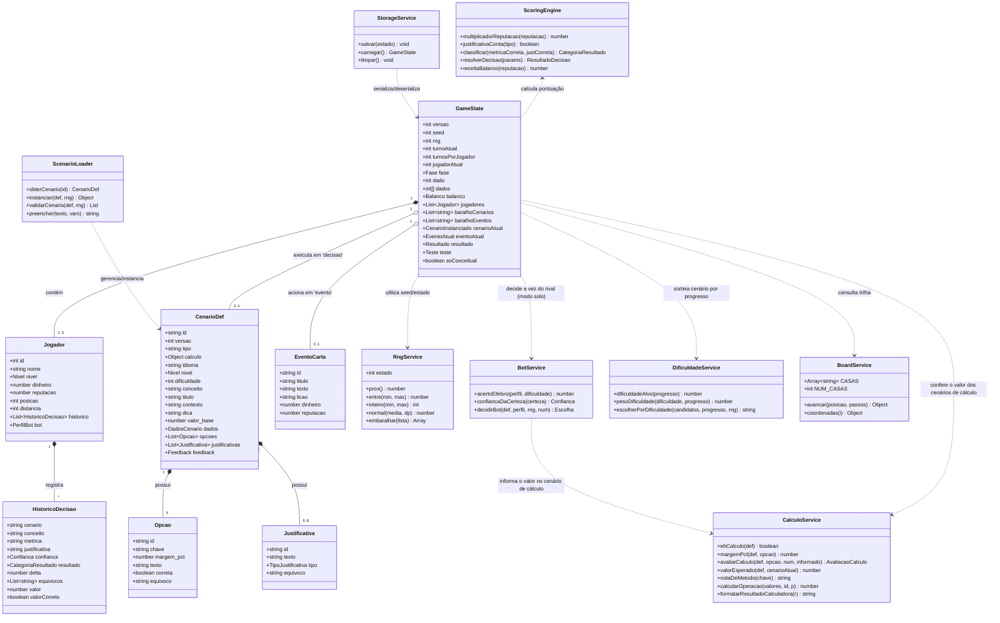
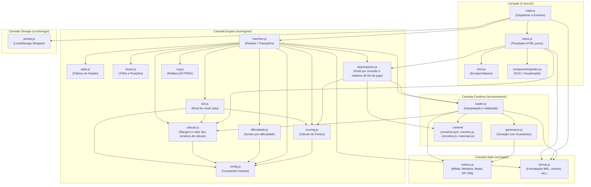

# Documentação Arquitetural e Diagramas UML - Fisher SA

Este documento consolida a modelagem UML e arquitetural do projeto **Fisher SA**, detalhando sua estrutura de dados, máquina de estados, ciclo de vida de execução e separação em camadas.

---

## 1. Diagrama de Classes e Entidades (Estrutural)

Modela o estado da partida, as entidades de negócio (jogadores, cenários, cartas de evento) e os serviços/módulos do sistema.



---

## 2. Diagrama de Máquina de Estados (Comportamental)

Modela o fluxo de fases do motor de turnos em `src/engine/machine.js`. Cada transição é uma função pura `(estado, acao) -> novoEstado`.

```mermaid
stateDiagram-v2
    [*] --> MENU : Início / Sem jogo ativo
    
    MENU --> ROLAR_DADO : NOVA partida / CONTINUAR_SALVA
    
    state TurnoAtivo {
        [*] --> ROLAR_DADO
        
        ROLAR_DADO --> ESCOLHER_METRICA : ROLAR (caiu em 'decisao')
        ROLAR_DADO --> MOSTRAR_EVENTO : ROLAR (caiu em 'evento')
        ROLAR_DADO --> MOSTRAR_BALANCO : ROLAR (caiu em 'balanco')
        
        state FluxoDecisao {
            ESCOLHER_METRICA --> ESCOLHER_METRICA : ABRIR_DICA (só iniciante; marca dicaUsada e reduz o bônus de confiança)
            ESCOLHER_METRICA --> ESCOLHER_JUSTIFICATIVA : METRICA(id) (só pessoa, cenário comum)
            ESCOLHER_METRICA --> INFORMAR_VALOR : METRICA(id) (só pessoa, cenário de cálculo)
            INFORMAR_VALOR --> ESCOLHER_JUSTIFICATIVA : VALOR(número ou texto pt-BR)
            ESCOLHER_METRICA --> MOSTRAR_RESULTADO : DECIDIR_BOT (só rival do modo solo)
            ESCOLHER_JUSTIFICATIVA --> ESCOLHER_CONFIANCA : JUSTIFICATIVA(id)
            ESCOLHER_CONFIANCA --> MOSTRAR_RESULTADO : CONFIANCA('chute' | 'duvida' | 'provavel' | 'confiante' | 'certeza')
        }
        
        MOSTRAR_RESULTADO --> ValidaFimTurno : CONTINUAR
        MOSTRAR_EVENTO --> ValidaFimTurno : CONTINUAR
        MOSTRAR_BALANCO --> ValidaFimTurno : CONTINUAR
        
        state ValidaFimTurno <<choice>>
        ValidaFimTurno --> ROLAR_DADO : turnoAtual <= turnosPorJogador\n(próximo jogador ou nova rodada)
    }

    ValidaFimTurno --> FIM_DE_JOGO : turnoAtual > turnosPorJogador
    FIM_DE_JOGO --> MENU : NOVA partida (limpa storage)
```



---

## 3. Diagrama de Sequência (Comportamental)

Demonstra a ordem de chamada e a comunicação assíncrona/reativa orientada por eventos desde a interação na interface até a persistência no armazenamento.

```mermaid
sequenceDiagram
    autonumber
    actor Jogador as Jogador (User)
    participant UI as UI (main.js / views.js)
    participant Machine as Engine (machine.js)
    participant RNG as RNG (rng.js)
    participant Board as Board (board.js)
    participant Loader as ScenarioLoader (loader.js)
    participant Scoring as Scoring (scoring.js)
    participant Storage as Persist (persist.js)

    Jogador->>UI: Clica em "Rolar os dados" (data-acao="ROLAR")
    UI->>Machine: reduzir(estado, { tipo: 'ROLAR' })
    activate Machine
    Machine->>RNG: inteiro(1, 6)
    RNG-->>Machine: d1 (ex: 4)
    Machine->>RNG: inteiro(1, 6)
    RNG-->>Machine: d2 (ex: 3)
    Note over Machine: dado = d1 + d2
    Machine->>Board: avancar(j.posicao, dado)
    Board-->>Machine: { posicao, passouInicio }
    
    alt Passou pelo início
        Machine->>Scoring: receitaBalanco(reputacao)
        Scoring-->>Machine: receita
        Note over Machine: Aplica balanço financeiro
    end

    Note over Machine: distancia += dado; progresso = distancia / (turnos × 7)

    alt Casa == 'decisao'
        Machine->>Machine: sacarCenario (peso por dificuldade vs. progresso)
        Machine->>Loader: instanciar(obterCenario(id), rng)
        Loader-->>Machine: { series, num, vars }
        Note over Machine: fase = 'ESCOLHER_METRICA'
    else Casa == 'evento'
        Note over Machine: Aplica efeito e fase = 'MOSTRAR_EVENTO'
    else Casa == 'balanco'
        Note over Machine: fase = 'MOSTRAR_BALANCO'
    end
    
    Machine-->>UI: novoEstado
    deactivate Machine
    
    opt Vez do rival (modo solo) e fase 'ESCOLHER_METRICA'
        UI->>Machine: reduzir(estado, { tipo: 'DECIDIR_BOT' })
        Machine->>Machine: decidirBot(def, perfil, rng, num) e pontua como uma pessoa
        Machine-->>UI: novoEstado (fase: 'MOSTRAR_RESULTADO')
    end

    UI->>Storage: salvar(novoEstado)
    UI->>UI: render()
    
    Note over Jogador, UI: O Jogador seleciona Métrica -> (Valor calculado, só em cenário de cálculo) -> Justificativa -> Confiança
    Jogador->>UI: Confirma Confiança ("certeza")
    UI->>Machine: reduzir(estado, { tipo: 'CONFIANCA', valor: 'certeza' })
    activate Machine
    Machine->>Scoring: resolverDecisao(params)
    Scoring-->>Machine: { delta, deltaReputacao, categoria, ... }
    Machine-->>UI: novoEstado (fase: 'MOSTRAR_RESULTADO')
    deactivate Machine
    
    UI->>Storage: salvar(novoEstado)
    UI->>UI: render()
```

---

## 4. Diagrama de Pacotes e Arquitetura (Módulos)

Apresenta as camadas do projeto e a direção das dependências entre módulos ES6:



---

## 5. Descrição dos Componentes Principais

| Módulo | Responsabilidade Principal |
| :--- | :--- |
| **`src/engine/machine.js`** | Máquina de estados finitos que orquestra as transições a partir de ações do jogador. |
| **`src/engine/state.js`** | Fábrica inicial do estado (`novoJogo`, que aceita `soConceitual`, para excluir os cenários de cálculo, e os atalhos de teste do menu: casa forçada e baralho restrito, ver `fisher.md` 5.8.1) e funções seletoras puras (`jogadorAtual`, `ehBot`, `classificacao`, `progressoDoJogador`). |
| **`src/engine/bot.js`** | Rival do modo solo: acerta métrica e justificativa com a probabilidade do perfil (menor nos cenários difíceis), escolhe distratores ao errar e deriva a confiança de uma certeza interna ruidosa. Perfis em `config.js`, calibração em `scripts/simular-bot.mjs` (`fisher.md` 3.11). |
| **`src/engine/dificuldade.js`** | Dificuldade-alvo a partir do progresso do jogador e sorteio ponderado de cenários do baralho. |
| **`src/engine/rng.js`** | Gerador pseudo-aleatório determinístico baseado no algoritmo `mulberry32` com estado serializável em 32-bits. |
| **`src/engine/desempenho.js`** | Perfil de desempenho do jogador a partir do histórico: domínio e diagnóstico por conceito, pontos fortes, deficiências, equívocos recorrentes e calibração da certeza; e o relatório de fim de jogo (`relatorioDesempenho`): acertos e erros, assuntos que mais e menos domina e sugestões de estudo com os materiais de `content/materiais.js` (`fisher.md` 4.6). |
| **`src/engine/calculo.js`** | Cenários de cálculo (`fisher.md` 4.7): reconhece o tipo, avalia o valor informado contra o valor exato da métrica escolhida dentro de uma margem relativa e fornece as notas de método (percentil linear, desvio padrão amostral) e as operações da calculadora embutida na etapa do valor (`calcularOperacao`, que não altera o estado). |
| **`src/engine/scoring.js`** | Algoritmos de pontuação, multiplicadores de reputação, regras de aposta e crise de imagem. |
| **`src/scenarios/generators.js`** | Síntese de dados estatísticos com validação de invariantes conceituais. |
| **`src/scenarios/loader.js`** | Instanciação de cenários, cálculo de resumo estatístico e substituição de variáveis nos enunciados. |
| **`src/stats/metrics.js`** | Cálculos estatísticos fundamentais (média, mediana, moda, desvio padrão, percentil 90). |
| **`src/stats/format.js`** | Formatação dos números por formato de cenário (R$, dias, minutos, s, ...) e leitura (`lerNumero`) do valor digitado em pt-BR. |
| **`src/storage/persist.js`** | Camada de persistência em `window.localStorage` para salvamento automático a cada transição. |
| **`src/ui/`** | Renderização reativa baseada em strings HTML puras e SVG (`grafico.js`), delegando ações de volta ao `main.js`. |
